<!-- Colorful animated GitHub profile for @sreeram2124 -->

  

   

  

   

  
  
  

---

## 👋 Hey, I'm Sreeram!

🎓 Computer Science & Engineering graduate specializing in **Big Data Analytics**.

I like working at the intersection of **data, visuals, and real-world problems**—using analysis, dashboards, and machine-learning projects to make information easier to understand.

<table>
  <tr>
    <td width="50%" valign="top">
      <h3>🎯 What I focus on</h3>
      📊 Data Analytics & Business Intelligence 
      📈 Power BI dashboards, KPIs & storytelling 
      🐍 Python-based data analysis 
      🤖 Applied Machine Learning 
      🌍 Environmental & sales data projects
    </td>
    <td width="50%" valign="top">
      <h3>💼 Roles I'm targeting</h3>
      
      
      
        
      I’m interested in roles where I can turn data into clear reporting, useful dashboards, and actionable business insights.
    </td>
  </tr>
</table>

## 🌈 Data in Motion

  

## 🚀 Featured Projects

<table>
  <tr>
    <td width="50%" valign="top">
      <h3>🍫 Chocolate Sales Analytics</h3>
      
      
      
Explore sales performance and business metrics through a Power BI dashboard project.

      <a href="https://github.com/sreeram2124/Chocolate-Sales-PowerBI-Dashboard">🔗 Explore repository</a>
    </td>
    <td width="50%" valign="top">
      <h3>🌍 Global Warming Dashboard</h3>
      
      
      
Explore global-warming and climate data through visual reporting.

      <a href="https://github.com/sreeram2124/GlobalWarming-power-BI-project">🔗 Explore repository</a>
    </td>
  </tr>
  <tr>
    <td width="50%" valign="top">
      <h3>🔥 Wildfire Smoke & AQI Trends</h3>
      
      
      
Explore wildfire signals, smoke, and air-quality trends using NASA FIRMS data.

      <a href="https://github.com/sreeram2124/wildfire-smoke-prediction-and-AQI-trends-using-NASA-FIRMS">🔗 Explore repository</a>
    </td>
    <td width="50%" valign="top">
      <h3>🏙️ Smart City & NASA FIRMS</h3>
      
      
      
A smart-city themed project using NASA FIRMS data to explore environmental information.

      <a href="https://github.com/sreeram2124/SMART-CITY-NASA-FIRMS">🔗 Explore repository</a>
    </td>
  </tr>
</table>

**More projects**

## 🧰 My Toolkit

*Tools and technologies I've used across projects and learning—not a claim of expert-level proficiency in every item.*

### 📊 Analytics & Business Intelligence

  
  
  
  

### 🐍 Programming & Data Analysis

  
  
  
  
  
  

### 🤖 Machine Learning & AI

  
  
  

### 🗄️ Databases, Cloud & Data Tools

  
  
  
  
  
  

### 🧑‍💻 Workflow & Visualization

  
  
  
  

## ⚡ How I Like to Work

  
  
  
  

---

  <h3>💌 Let's connect</h3>
  
  
    
  <b>Curious by nature. Driven by data. Focused on useful insights. ✨</b>

